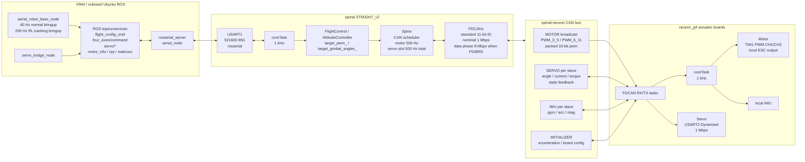

# Dragon Hardware Communication Chain

This note documents the current embedded communication path used by the Dragon
hardware stack:

```text
VIM4 / ROS  <=>  spinal flight controller  <=>  neuron actuator boards
```

The scope here is the real-machine Dragon configuration under
`robots/dragon/config/quad/v1_5_202601` and the H7_v2 spinal firmware. Older
`neuron_f1` and `neuron_f4` projects remain in the tree, but the FDCAN timing and
FreeRTOS task layout match `neuron_g4` most closely.

## Hardware-System-Framework



## VIM4 <=> spinal

The real-machine Dragon launch includes the spinal bridge through
[`sensors.launch.xml`](../launch/includes/v1_5_202601/sensors.launch.xml#L13).
The bridge is `rosserial_server serial_node`, configured in
[`bridge.launch`](../../../aerial_robot_nerve/spinal/launch/bridge.launch#L10).

Current real-machine serial settings:

```text
device: /dev/flight_controller
baud:   921600
mode:   UART rosserial
```

The matching H7_v2 firmware side uses USART1 at 921600 baud:
[`main.c`](../../../aerial_robot_nerve/spinal/mcu_project/boards/stm32H7_v2/Src/main.c#L905).
The H7_v2 `coreTask` initializes rosserial on `huart1`:
[`main.c`](../../../aerial_robot_nerve/spinal/mcu_project/boards/stm32H7_v2/Src/main.c#L1205).

The normal Dragon bringup runs `aerial_robot_base_node` at 40 Hz
[`bringup.launch`](../launch/bringup.launch#L85). The RL tracking bringup uses a
200 Hz base loop, while still using the same embedded transport path.

Main ROS endpoints visible to spinal:

| Direction | Name | Content |
| --- | --- | --- |
| VIM4 -> spinal | `flight_config_cmd` | arm on/off, force landing, integration control |
| VIM4 -> spinal | `four_axes/command` | target roll/pitch/yaw and base thrust |
| VIM4 -> spinal | `servo/target_states` | servo indexes and target angles |
| VIM4 -> spinal | `servo/target_current` | servo indexes and target currents |
| VIM4 -> spinal | `servo/torque_enable` | servo indexes and torque enable flags |
| VIM4 -> spinal | `motor_info`, `rpy/gain`, matrices | motor conversion and controller parameters |
| spinal -> VIM4 | `motor_pwms` | current motor PWM command values |
| spinal -> VIM4 | `servo/states` | servo index, angle, temperature, load/current, error |
| spinal -> VIM4 | `servo/torque_states` | torque enable state for all servos |
| spinal -> VIM4 | `flight_config_ack` | accepted/safety flight command acknowledgement |

The flight-control ROS topic names are constructed in
[`attitude_control.cpp`](../../../aerial_robot_nerve/spinal/mcu_project/lib/Jsk_Lib/flight_control/attitude/attitude_control.cpp#L45)
and [`flight_control.h`](../../../aerial_robot_nerve/spinal/mcu_project/lib/Jsk_Lib/flight_control/flight_control.h#L65).
The servo ROS topics and board services are constructed in
[`spine.cpp`](../../../aerial_robot_nerve/spinal/mcu_project/lib/Hydrus_Lib/Spine/spine.cpp#L38).

Message fields:

```text
ServoControlCmd: uint8[] index, int16[] angles
ServoTorqueCmd:  uint8[] index, uint8[] torque_enable
ServoStates:     time stamp, spinal/ServoState[] servos
Pwms:            uint16[] motor_value
FourAxisCommand: float32[3] angles, float32[] base_thrust
```

See:

- [`ServoControlCmd.msg`](../../../aerial_robot_nerve/spinal/msg/ServoControlCmd.msg#L1)
- [`ServoTorqueCmd.msg`](../../../aerial_robot_nerve/spinal/msg/ServoTorqueCmd.msg#L1)
- [`ServoStates.msg`](../../../aerial_robot_nerve/spinal/msg/ServoStates.msg#L1)
- [`Pwms.msg`](../../../aerial_robot_nerve/spinal/msg/Pwms.msg#L1)
- [`FourAxisCommand.msg`](../../../aerial_robot_nerve/spinal/msg/FourAxisCommand.msg#L1)

## spinal firmware timing

The H7_v2 spinal firmware starts a 1 ms FreeRTOS timer:
[`main.c`](../../../aerial_robot_nerve/spinal/mcu_project/boards/stm32H7_v2/Src/main.c#L323).

Each 1 kHz core tick runs:

```text
Spine::send()
imu/baro/gps update
state estimator update
FlightControl::update()
Spine::update()
```

The exact loop is in
[`main.c`](../../../aerial_robot_nerve/spinal/mcu_project/boards/stm32H7_v2/Src/main.c#L1218).

Important compile-time note: H7_v2 contains a direct DShot path, but the current
H7_v2 configuration sets `DSHOT 0`, so the default rotor path is through
spinal-neuron CAN and neuron TIM PWM rather than direct DShot output:
[`config.h`](../../../aerial_robot_nerve/spinal/mcu_project/lib/Jsk_Lib/configs/STM32H7_v2/config.h#L81).

## spinal <=> neuron CAN protocol

The CAN standard ID is split as:

```text
bits 10..8: device_id
bits  7..4: message_id
bits  3..0: slave_id
```

Defined IDs:

```text
MASTER_ID    = 0
BROADCAST_ID = 15
DEVICEID_MOTOR       = 0
DEVICEID_IMU         = 1
DEVICEID_SERVO       = 2
DEVICEID_INITIALIZER = 7
```

The shared constants are in
[`can_constants.h`](../../../aerial_robot_nerve/spinal/mcu_project/lib/Jsk_Lib/CAN/can_constants.h#L18).

Current H7_v2 FDCAN settings are configured in
[`main.c`](../../../aerial_robot_nerve/spinal/mcu_project/boards/stm32H7_v2/Src/main.c#L549):

```text
frame format: FDCAN_FRAME_FD_BRS
nominal:      80 MHz / (1 * (1 + 63 + 16)) = 1 Mbps
data phase:   80 MHz / (1 * (1 + 7 + 2))   = 8 Mbps
```

The code sends classic CAN frames when DLC is <= 8 bytes, which covers the
current motor and servo command frames.

CAN message content:

| Device | Message ID | Direction | Payload |
| --- | --- | --- | --- |
| MOTOR | `PWM_0_5` | spinal -> broadcast neuron | packed PWM for slaves 1..6 |
| MOTOR | `PWM_6_11` | spinal -> broadcast neuron | packed PWM for slaves 7..12 |
| SERVO | `SERVO_ANGLE` | spinal -> one neuron | target position, one uint16 per local servo |
| SERVO | `SERVO_CURRENT` | spinal -> one neuron | target current plus torque-enable bit |
| SERVO | `SEND_SERVO_LIST[i]` | neuron -> spinal | angle, temp, status, current, error |
| IMU | `GYRO`, `ACC`, `MAG` | neuron -> spinal | int16 xyz vectors |
| INITIALIZER | enum/config IDs | both directions | board discovery and persistent servo config |

CAN scheduling in `Spine::send()`:

```text
even 1 kHz ticks: motor broadcast -> 500 Hz
odd  1 kHz ticks: one neuron servo command slot -> 500 Hz total
```

For `N` neuron boards, a single board receives servo commands at `500 / N` Hz.
For a 4-neuron Dragon, that is 125 Hz per neuron. See
[`spine.cpp`](../../../aerial_robot_nerve/spinal/mcu_project/lib/Hydrus_Lib/Spine/spine.cpp#L241).

The neuron_g4 side uses a 1 ms core timer
[`main.c`](../../../aerial_robot_nerve/neuron/neuron_g4/Core/Src/main.c#L252).
When a neuron receives a servo angle frame, it releases the CAN TX task, which
then sends servo and IMU feedback:
[`main.c`](../../../aerial_robot_nerve/neuron/neuron_g4/Core/Src/main.c#L780).

## Rotor control path

The active path is:

```text
ROS command / controller params
  -> spinal FlightControl / AttitudeController
  -> target_pwm_[i]
  -> Spine::update(): pwm_bit = target_pwm * 2000 - 1000
  -> CAN MOTOR broadcast
  -> neuron Motor::receiveDataCallback()
  -> TIM PWM CCR update
  -> ESC / rotor
```

`Spine::update()` converts `target_pwm_` into the CAN motor value:
[`spine.cpp`](../../../aerial_robot_nerve/spinal/mcu_project/lib/Hydrus_Lib/Spine/spine.cpp#L267).

The spinal CAN motor sender packs up to six 10-bit motor values into each
8-byte CAN frame and broadcasts them:
[`can_motor.cpp`](../../../aerial_robot_nerve/spinal/mcu_project/lib/Hydrus_Lib/CANDevice/motor/can_motor.cpp#L22).

On neuron, `Motor::receiveDataCallback()` selects the PWM value by `slave_id`
from either `PWM_0_5` or `PWM_6_11`. It then updates timer compare registers:

```text
raw_val = (pwm + 1000) / 2000 * timer_period
TIMx->CCR1 = raw_val
TIMx->CCR2 = raw_val  // STM32G4 builds
```

See [`motor.cpp`](../../../aerial_robot_nerve/neuron/neuronlib/Motor/motor.cpp#L27).
If CAN times out, neuron forces the rotor output to zero:
[`motor.cpp`](../../../aerial_robot_nerve/neuron/neuronlib/Motor/motor.cpp#L69).

Motor conversion parameters for the ROS/controller side come from
[`MotorInfo.yaml`](../config/quad/v1_5_202601/MotorInfo.yaml). The current YAML
uses a 0.55..0.95 duty range, corresponding to the usual 1100..1900 us ESC
command window.

## Servo control path

Servo commands have two possible hardware layers:

```text
VIM4 ROS
  -> servo/target_states, servo/target_current, servo/torque_enable
  -> spinal Spine servo callbacks
  -> CAN SERVO_ANGLE and SERVO_CURRENT
  -> neuron Servo::receiveDataCallback()
  -> DynamixelSerial instruction queue
  -> USART2 1 Mbps Dynamixel bus
```

The spinal callbacks write target values into each `CANServo`:

- position callback:
  [`spine.cpp`](../../../aerial_robot_nerve/spinal/mcu_project/lib/Hydrus_Lib/Spine/spine.cpp#L94)
- current callback:
  [`spine.cpp`](../../../aerial_robot_nerve/spinal/mcu_project/lib/Hydrus_Lib/Spine/spine.cpp#L103)
- torque callback:
  [`spine.cpp`](../../../aerial_robot_nerve/spinal/mcu_project/lib/Hydrus_Lib/Spine/spine.cpp#L113)

The spinal CAN servo sender emits two frames per target neuron:

```text
SERVO_ANGLE:   uint16 per local servo, high bit is ack flag, low 15 bits are goal position
SERVO_CURRENT: uint16 per local servo, high bit is torque enable, low 15 bits are goal current
```

See [`can_servo.cpp`](../../../aerial_robot_nerve/spinal/mcu_project/lib/Hydrus_Lib/CANDevice/servo/can_servo.cpp#L17).

On neuron_g4, the local Dynamixel interface is USART2 at 1 Mbps:
[`main.c`](../../../aerial_robot_nerve/neuron/neuron_g4/Core/Src/main.c#L632).
The servo task calls `servo_.update()` every 1 ms:
[`main.c`](../../../aerial_robot_nerve/neuron/neuron_g4/Core/Src/main.c#L815).

Dynamixel command/read frequencies are defined in
[`dynamixel_serial.h`](../../../aerial_robot_nerve/neuron/neuronlib/Servo/Dynamixel/dynamixel_serial.h#L230):

```text
goal position/current sync write: 20 ms -> 50 Hz
present position sync read:       20 ms -> 50 Hz
present current read:             200 ms -> 5 Hz
temperature / moving / error:     200 ms -> 5 Hz
```

Dragon's servo mapping and scale factors are configured in
[`Servo.yaml`](../config/quad/v1_5_202601/Servo.yaml). That file defines the
joint servos, gimbal servos, Dynamixel ID mapping, angle scale, zero offsets,
and torque/current scale used by the ROS model and bridge.

## Practical rate summary

| Layer | Rate |
| --- | --- |
| `aerial_robot_base_node`, normal bringup | 40 Hz |
| `aerial_robot_base_node`, RL tracking bringup | 200 Hz |
| spinal core loop | 1 kHz |
| rosserial spin/publish tasks | event-driven, checked around the RTOS task cadence |
| spinal -> neuron motor CAN broadcast | 500 Hz |
| spinal -> neuron servo CAN slots | 500 Hz total, `500 / slave_num` per neuron |
| spinal -> VIM4 `servo/states` | 50 Hz |
| spinal -> VIM4 `servo/torque_states` | 1 Hz |
| neuron core task | 1 kHz |
| neuron servo update task | 1 kHz |
| Dynamixel goal write / position read | 50 Hz |
| Dynamixel current/temp/moving/error reads | 5 Hz |

## Key file index

| Area | File |
| --- | --- |
| Dragon real-machine bridge include | [`sensors.launch.xml`](../launch/includes/v1_5_202601/sensors.launch.xml#L13) |
| rosserial bridge launch | [`bridge.launch`](../../../aerial_robot_nerve/spinal/launch/bridge.launch#L10) |
| Dragon normal bringup | [`bringup.launch`](../launch/bringup.launch#L85) |
| spinal H7_v2 main firmware | [`main.c`](../../../aerial_robot_nerve/spinal/mcu_project/boards/stm32H7_v2/Src/main.c) |
| spinal H7_v2 config flags | [`config.h`](../../../aerial_robot_nerve/spinal/mcu_project/lib/Jsk_Lib/configs/STM32H7_v2/config.h#L81) |
| spinal ROS flight control endpoints | [`attitude_control.cpp`](../../../aerial_robot_nerve/spinal/mcu_project/lib/Jsk_Lib/flight_control/attitude/attitude_control.cpp#L45) |
| spinal flight config endpoints | [`flight_control.h`](../../../aerial_robot_nerve/spinal/mcu_project/lib/Jsk_Lib/flight_control/flight_control.h#L65) |
| spinal-neuron bridge logic | [`spine.cpp`](../../../aerial_robot_nerve/spinal/mcu_project/lib/Hydrus_Lib/Spine/spine.cpp) |
| CAN constants | [`can_constants.h`](../../../aerial_robot_nerve/spinal/mcu_project/lib/Jsk_Lib/CAN/can_constants.h#L18) |
| CAN motor packing | [`can_motor.cpp`](../../../aerial_robot_nerve/spinal/mcu_project/lib/Hydrus_Lib/CANDevice/motor/can_motor.cpp#L22) |
| CAN servo packing/state | [`can_servo.cpp`](../../../aerial_robot_nerve/spinal/mcu_project/lib/Hydrus_Lib/CANDevice/servo/can_servo.cpp#L17) |
| neuron_g4 firmware | [`main.c`](../../../aerial_robot_nerve/neuron/neuron_g4/Core/Src/main.c) |
| neuron rotor PWM output | [`motor.cpp`](../../../aerial_robot_nerve/neuron/neuronlib/Motor/motor.cpp#L27) |
| neuron Dynamixel timing | [`dynamixel_serial.h`](../../../aerial_robot_nerve/neuron/neuronlib/Servo/Dynamixel/dynamixel_serial.h#L230) |
| Dragon motor config | [`MotorInfo.yaml`](../config/quad/v1_5_202601/MotorInfo.yaml) |
| Dragon servo config | [`Servo.yaml`](../config/quad/v1_5_202601/Servo.yaml) |

